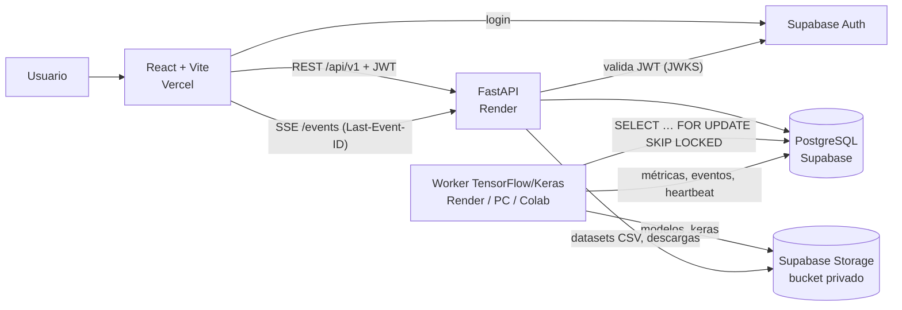
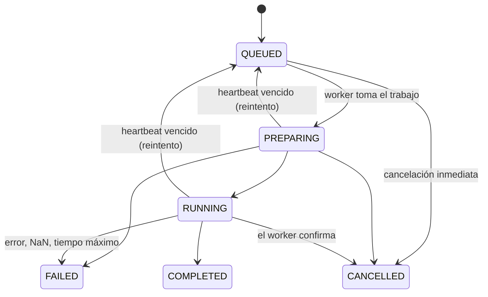

# Arquitectura de Aurora VIII

## Componentes

| Capa | Responsabilidad | Implementación |
|---|---|---|
| Presentación | Shell, rutas protegidas, diseñador, visualización en vivo | React 18, Vite, TypeScript, Canvas 2D, Recharts |
| Estado y datos | Cache de consultas, cliente tipado, estados de carga/error | TanStack Query, `lib/api.ts`, `lib/sse.ts` |
| API | Autorización, validación, límites, contratos OpenAPI | FastAPI, Pydantic (esquemas estrictos `extra=forbid`) |
| Asíncrono | Cola, prioridad, reintentos, cancelación cooperativa | Tabla `training_jobs` + `SKIP LOCKED` + heartbeat |
| Motor ML | Construcción desde configuración validada, entrenamiento, evaluación, serialización | TensorFlow 2.21 / Keras 3 |
| Persistencia | Metadatos y métricas en filas; archivos en objetos | PostgreSQL 16 / Supabase, Supabase Storage |
| Tiempo real | Estado, época, métricas, instantáneas de la red | SSE con reanudación; REST sigue siendo la fuente de verdad |
| Operación | Contenedores, logs estructurados, CI | Docker, JSON logs con `X-Request-ID`, GitHub Actions |

## Decisiones técnicas

**Cola en PostgreSQL, no Redis.** `SELECT … FOR UPDATE SKIP LOCKED` permite varios workers sin duplicar trabajos y
elimina un servicio más que pagar y operar. El worker puede vivir en cualquier máquina con acceso a la BD.

**El entrenamiento nunca corre en la petición HTTP.** La API encola y devuelve `202 + job_id`. El worker emite
progreso persistido; si el navegador se cierra, el entrenamiento continúa.

**Tiempo real honesto.** El canal es SSE (no *polling* desde el navegador). Cada evento tiene un `id` creciente de
`job_events`; al reconectar el cliente envía `Last-Event-ID` y recibe exactamente lo que se perdió. Además vuelve a
pedir el estado por REST. En el servidor, el endpoint SSE consulta la tabla cada 0,4 s (compatible con cualquier
pooler; `LISTEN/NOTIFY` no funciona en el pooler en modo transacción).

**Validación en backend sin TensorFlow.** `modules/architectures.py` propaga formas capa por capa y cuenta parámetros
analíticamente; la API queda en ~100 MB de RAM. Una prueba verifica que el conteo coincide con `model.count_params()`.

**Visualización de la red.** El worker define capas «visibles» (entrada, Dense, Conv2D, recurrentes, salida) y
muestrea hasta 14 neuronas por capa. En cada instantánea envía, para una muestra que rota por el conjunto de
validación: activación por neurona (promedio espacial/temporal, normalizada por capa), matriz de pesos entre
neuronas visibles (kernels de convolución promediados espacialmente; compuertas LSTM/GRU promediadas; capas tras
`Flatten` agrupadas por canal) y la predicción. Para datos 2D añade una malla 28×28 de la frontera de decisión; para
GAN, 250 puntos generados. El frontend interpola entre instantáneas a 60 fps y genera pulsos donde
`|peso| × |activación de origen|` es alto. Frecuencia: ≤ 1 instantánea/0,9 s durante la época y una al final de
cada época (limitada a 0,45 s), para no saturar la BD.

**Modo observación.** Con datasets pequeños una época dura milisegundos. El parámetro `observe` (activo por
defecto) garantiza ≥ 150 ms por época para que el aprendizaje sea visible; se desactiva para máxima velocidad.

## Máquina de estados

La cancelación de un trabajo en marcha es una **solicitud** (`cancel_requested`); el worker la detecta entre lotes
(cada ≤ 0,8 s) y confirma el estado final con el motivo. Si un worker deja de enviar heartbeat por 120 s, el trabajo
se reencola (hasta `max_attempts = 2`) o falla con un mensaje claro.

## Modelo de datos

| Tabla | Campos clave | Propósito |
|---|---|---|
| `users` | auth_subject (sub del JWT), email, is_admin, status | Identidad de aplicación |
| `projects` | name, description, problem, tags (jsonb), owner_id, status | Proyecto de IA |
| `project_members` | (project_id, user_id), role ∈ lead/engineer/reviewer/reader | Acceso colaborativo |
| `datasets` | project_id (NULL = demo), version, kind, storage_key, metadata_json | Metadatos; archivo en Storage |
| `architectures` | family, config_json, summary_json, version, justification | Configuración validada y versionada |
| `training_jobs` | status, progress, params_json, priority, attempt, cancel_requested, heartbeat_at, trace_json, result_json | Ciclo de vida y trazabilidad |
| `training_metrics` | job_id, epoch, metric_name, metric_value | Series por época |
| `job_events` | id (bigserial), job_id, event_type, payload | Bitácora para SSE y reanudación |
| `model_versions` | version, storage_key, checksum (SHA-256), status, metrics_json | Artefactos inmutables |
| `audit_events` | actor_id, project_id, action, metadata_json | Auditoría |
| `system_settings` | key, value_json | Límites editables y heartbeat del worker |

`trace_json` guarda: versión de código (`RENDER_GIT_COMMIT`), arquitectura (nombre, versión, hash de configuración),
dataset (nombre, versión, SHA-256), semilla, versiones de TensorFlow/Keras, worker y tamaños de cada partición.

## Seguridad

- **Autenticación**: Supabase Auth; la API valida firma (JWKS ES256/RS256 o HS256 legado), emisor, audiencia y
  expiración. Modo `local` solo para desarrollo (desactivado con `ENVIRONMENT=prod`).
- **Autorización**: RBAC por proyecto en cada endpoint (`core/permissions.py`). Un recurso ajeno responde **404**
  (no revela que existe). El primer administrador se define con `BOOTSTRAP_ADMIN_EMAILS`.
- **Entradas**: esquemas Pydantic estrictos; arquitecturas validadas en backend; CSV validados por extensión, tamaño,
  codificación, bytes binarios y contenido numérico. Nunca se ejecuta contenido subido.
- **Secretos**: solo en variables del servidor. El bundle de React recibe la URL y la clave pública de Supabase.
- **Datos**: RLS activo sin políticas (PostgREST no expone nada); bucket privado; logs con redacción de tokens.
- **Abuso**: límite de tasa por cliente, cuotas de trabajos por usuario/proyecto, límites de épocas, parámetros,
  tamaño de carga y duración.
- **Errores**: el usuario ve un mensaje controlado con referencia; el detalle técnico queda en logs protegidos.
